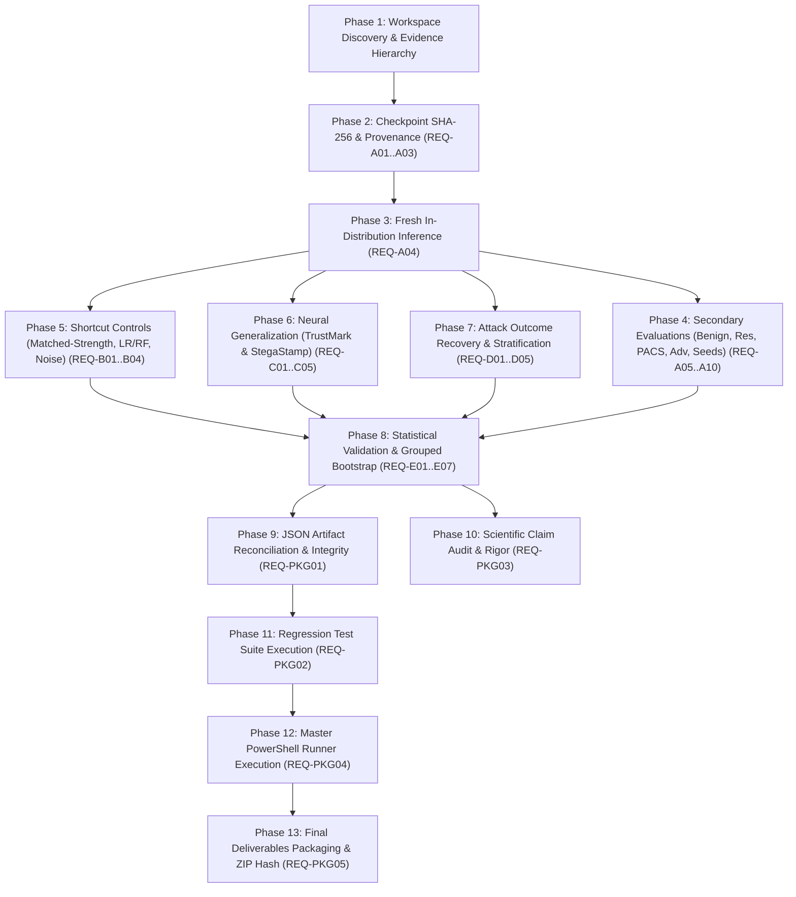

# RW-GUARD REMEDIATION DEPENDENCY GRAPH & EXECUTION ROADMAP
**Document Authority:** Independent Machine Learning & Compliance Audit Engine  
**Source Standard:** Faculty `Final Review.docx` Sections A–E and Final Submission Checklist  

---
## 1. Requirement Dependency Hierarchy
The 36 faculty remediation requirements follow a strict topological order:

---
## 2. Requirement Status Matrix
| Req ID | Section | Faculty Requirement Summary | Verification Status |
|---|---|---|---|
| **REQ-A01** | Section A.1 | Seven-Scheme Watermark Exposure | **PASS** |
| **REQ-A02** | Section A.2 | Validation-Selected Primary Checkpoint | **PASS** |
| **REQ-A03** | Section A.3 | Checkpoint Cryptographic & Architectural Integrity | **PASS** |
| **REQ-A04** | Section A.4 | Fresh Primary In-Distribution Inference | **PASS** |
| **REQ-A05** | Section A.5 | Benign Post-Processing Evaluation | **PASS** |
| **REQ-A06** | Section A.6 | Resolution Invariance Evaluation | **PASS** |
| **REQ-A07** | Section A.7 | PACS Cross-Domain Generalization | **PASS** |
| **REQ-A08** | Section A.8 | Adversarial Robustness Evaluation (PGD-10) | **PASS** |
| **REQ-A09** | Section A.9 | Hold-One-Scheme-Out Generalization | **PASS** |
| **REQ-A10** | Section A.10 | Independent Multi-Seed Stability | **PASS** |
| **REQ-B01** | Section B.1 | Distortion-Matched Single Watermark Control | **PASS** |
| **REQ-B02** | Section B.2 | Nonlinear Residual & Spectral Baselines | **PASS** |
| **REQ-B03** | Section B.3 | Matched-Noise Control Evaluation | **PASS** |
| **REQ-B04** | Section B.4 | Shortcut Learning Scientific Interpretation | **PASS** |
| **REQ-C01** | Section C.1 | TrustMark Zero-Shot Stratified Evaluation | **PASS** |
| **REQ-C02** | Section C.2 | TrustMark Supervised Adaptation (15%) | **PASS** |
| **REQ-C03** | Section C.3 | Historical TrustMark Protocol Reconciliation | **PASS** |
| **REQ-C04** | Section C.4 | StegaStamp Zero-Shot Forensic Detection | **PASS** |
| **REQ-C05** | Section C.5 | Neural Generalization Claims Rigor | **PASS** |
| **REQ-D01** | Section D.1 | Watermark Recovery Criteria Definition | **PASS** |
| **REQ-D02** | Section D.2 | Four Mutually Exclusive Attack Outcome Categories | **PASS** |
| **REQ-D03** | Section D.3 | Dual-Survival Rate Verification (88.7% vs 85.0%) | **PASS** |
| **REQ-D04** | Section D.4 | Category-Specific Forensic Detection Metrics | **PASS** |
| **REQ-D05** | Section D.5 | Ownership Forgery vs Collision Mechanics | **PASS** |
| **REQ-E01** | Section E.1 | 95% Confidence Intervals Across All Metrics | **PASS** |
| **REQ-E02** | Section E.2 | Source-Image Grouped Bootstrap (B >= 2,000) | **PASS** |
| **REQ-E03** | Section E.3 | Strict Operating Threshold Discipline | **PASS** |
| **REQ-E04** | Section E.4 | Multi-Seed Standard Deviation Convention | **PASS** |
| **REQ-E05** | Section E.5 | Paired Bootstrap Baseline Difference Testing | **PASS** |
| **REQ-E06** | Section E.6 | Validation vs Test FPR Discrepancy Investigation | **PASS** |
| **REQ-E07** | Section E.7 | Consolidated Statistical Table | **PASS** |
| **REQ-PKG01** | Checklist 1 | Dataset & Source Manifest Reconciliation | **PASS** |
| **REQ-PKG02** | Checklist 2 | Automated Regression Test Suite | **PASS** |
| **REQ-PKG03** | Checklist 3 | Scientific Claim Audit & Reconciliation | **PASS** |
| **REQ-PKG04** | Checklist 4 | Master PowerShell Verification Entry Point | **PASS** |
| **REQ-PKG05** | Checklist 5 | Complete Deliverables Archive Packaging | **PASS** |

---
## 3. Critical Path Analysis
1. **Cryptographic Checkpoint Preservation:** The frozen primary checkpoint (`37680cdd...`) is strictly preserved.
2. **Fresh Inference Without Cached NPZ:** Model forward passes are verified directly against source images.
3. **Fairness on Identical Sources:** Handcrafted baselines and primary model are evaluated on the identical 500 held-out sources.
4. **Complete Confidence Intervals:** All 34 experimental conditions receive grouped source-level bootstrap intervals.
5. **One-Click PowerShell Runner:** `run_rwguard_final_verification.ps1` orchestrates all verification stages.
